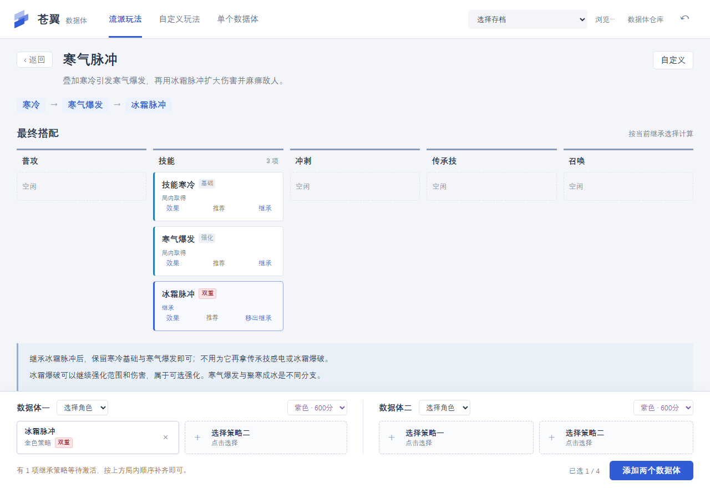
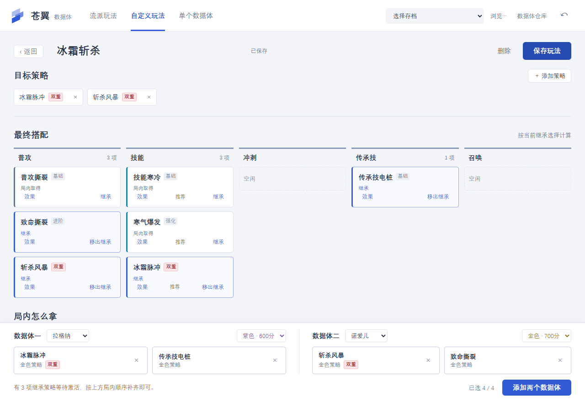

# 苍翼：混沌效应 · 数据体工具

先选流派，或保存自己的策略搭配，再决定带出哪四项继承。工具可一次添加两个配套数据体，也可单独添加一个。

**[下载 Windows EXE 和便携包](https://github.com/lzj960515/bb-ee-databody-tool/releases/latest)**



## 使用

1. 退出游戏，等待 Steam 云同步完成。
2. 在右上角选择目标存档，也可以点击“浏览…”指定存档文件。
3. 选择“流派玩法”，按元素查找玩法，点击打开。
4. 查看普攻、技能、冲刺、传承技、召唤五个位置的最终搭配。点击“效果”查看完整说明与品质；点击“继承”选入四个继承槽。
5. 为数据体一、数据体二分别选择角色和颜色，点击“添加两个数据体”，核对后确认保存。

四个继承槽初始为空，由你自己决定带什么。选择改变后，五位置图和“局内怎么拿”一起重新计算；已经通过继承省去的前置不再占位。图中标明“继承”和“局内取得”，可选强化单独列出。尚未激活的继承策略可以带入，按路线补齐基础后才生效。

选择策略的弹窗可搜索全部 297 项策略，支持元素筛选；双元素策略可以从任一元素找到。推荐项置顶，双重策略在列表、详情及继承槽中都有红色“双重”标记。

流派只描述策略搭配，不需要指定本局角色。创建的数据体仍需要载体角色；两个配套数据体选择不同角色。角色和继承功能仍需在游戏中可用。

“单个数据体”是独立的紧凑表单，选择角色、颜色和两项策略即可。“数据体仓库”以大表格展示已有数据体，支持搜索角色和策略。

## 玩法

内置纯光七红、雷枪光波、风暴火环、光波传递、撕裂斩杀、寒气脉冲、触手黑洞、毒弹催化、影链电桩、光枪冰锥 10 个玩法。全部 100 项双重策略保留在策略目录中，可自由加入自己的搭配。

纯光七红展示“先继承、后激活”的路线：光波快充、持久光阵、光阵吸引先继承，第四项自行选择；先补齐其他红策略，最后取得召唤光阵。提前取得光阵会影响后续抽取，因此继承选择与局内顺序都需要核对。

继承条件与局内获取条件分别计算。例如继承冰霜脉冲后，寒冷基础与寒气爆发即可激活，不再需要感电和冰霜爆破；继承斩杀风暴后仍需撕裂基础与致命撕裂，但不用再占一个风暴基础位置。选择普攻或技能等其他基础动作后，图会随之调整。

不同分支、契约和黑市还可能产生其他搭配；工具按默认规则检查，没有宣称穷举所有特殊玩法，局内选项也仍然随机出现。

## 自定义玩法



在“自定义玩法”中新建，或打开内置流派后点击“自定义”复制。添加想要的目标策略，再决定四项继承；目标策略没有四项限制。基础策略决定动作位置，工具补齐所需条件，按可取得的顺序生成路线，不把添加目标的点击顺序当作取得顺序。

填写名称并点击“保存玩法”，关闭工具后仍可载入修改。尚未填满或有冲突的搭配也能先保存，再继续调整；真正添加数据体时会检查角色、四项策略及继承冲突。

增删目标会立即显示，路线计算期间仍可继续编辑、保存或返回。复杂搭配若暂时算不完，会明确提示；这不表示搭配一定无解，可以先选择继承策略或减少目标后再试。

个人玩法保存在 `%LOCALAPPDATA%\bb-ee-databody-tool\custom-builds.json`，与 EXE、内置模板和游戏存档分开。升级或更换 EXE 不会覆盖个人玩法。“保存玩法”无需选择游戏存档；只有“添加数据体”会执行存档备份与写入。

## 数据体与存档

- 当前目录含 17 个角色、297 项策略。
- 数据体颜色可选紫色 600 分、金色 700 分，均可保存两项继承策略；两个数据体的颜色独立设置。
- 策略品质独立选择。部分双重策略在游戏里显示红色，其保存品质仍为 1–4。
- 新数据体附带角色初始属性、默认天赋和初始潜能，继承技能为该角色第一项、一级。
- 原有数据体和其他存档内容保持不变。仓库容量按当前已解锁页数校验。
- 两体作为一批操作，整批校验、一次备份、一次保存。无效选择、容量不足、游戏运行中或存档被外部修改时停止保存。

备份位于存档 `Save` 文件夹上一级的 `DataBodyToolBackups`，包含 `.bak` 和同名 `.json`，请一起保留。

恢复时选择目标存档，点击右上角“恢复备份”按钮并选择 `.bak`。工具校验所属路径与 SHA-256，恢复前再备份当前文件。恢复会撤销所选备份之后此存档的全部进度。

## 验证范围

游戏数据对应 Steam Windows App ID `2273430`、Build ID `25627491`。游戏更新后若策略目录或存档结构变化，需要重新核对工具。

规则验证使用游戏原方法进行受控重放，当前覆盖 10 个模板、全部 100 项双重策略的普通获取及继承路线，以及自定义组合等共 711 个场景、1,831 个状态；逐状态比较策略获取条件未发现差异。存档与桌面桥测试使用合成存档或副本，覆盖批量保存、失败不部分提交、取消、过期存档和恢复。网页界面通过实际浏览器与 Python 存档层联调，检查继承释放位置、全目录选择、自定义玩法保存与重新载入，以及默认和最小窗口布局。

这些检查不等于逐一进行游戏内战斗验证；实际伤害、连锁防递归、操作手感、特殊契约和掉落仍有实战边界。

## 运行与构建

Windows、Python 3.10+、系统 WebView2 运行时。常见 Windows 10/11 环境已带 WebView2。

```powershell
python -m venv .venv
.\.venv\Scripts\python.exe -m pip install -r requirements.txt
.\.venv\Scripts\python.exe launch.py
```

桌面界面为打包在本地的 HTML/CSS/JavaScript，由 WebView2 承载；不启动本地 HTTP 服务。存档事务保留在 Python 层。

```powershell
.\.venv\Scripts\python.exe -X utf8 -m unittest discover -s tests -v
node --test tests/frontend_model.test.cjs
```

公开源码不包含游戏提取资源或个人存档；依赖本地调查资源和 Node.js 的独立游戏校验测试会明确跳过。

在 `.venv` 安装 `pyinstaller==6.16.0` 后执行 `build.ps1`。默认输出 `dist/数据体工具.exe`；本地预览可用 `build.ps1 -Name '数据体工具-预览'`。网页和三份运行数据均打包进 EXE，不需要另装 Python。
